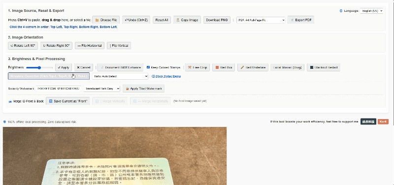

# 🛡️ 行政救星 Admin Savior

**[繁體中文](#-專案簡介) | [English](#-project-overview)**

---

## 📌 專案簡介

**《行政救星 Admin Savior》** 是一款專為行政人員、人資、公務機關與一般民眾打造的 **100% 純本機離線公文與雙證件影像處理工具**。

在日常申辦業務或處理公文時，我們常收到拍得歪斜、隔著透明卡套反光泛霧、或是帶有手機黑影的身分證與健保卡照片。傳統做法不是要開啟肥大的修圖與排版軟體耗時處理，就是得冒著敏感個資外洩的風險，將證件上傳至來路不明的免費線上工具。

本專案將所有影像矩陣運算與 PDF 生成技術封裝於**單一 `index.html` 檔案**中，透過瀏覽器內建的 `HTML5 Canvas` 在您自己的電腦或手機記憶體內完成處理——**無後端伺服器、無資料庫、無外部追蹤腳本，拔掉網路線或開啟飛航模式依然能 100% 正常運作**。

---

## 🚀 立即使用與離線下載

* 🌐 **線上立即開啟（電腦 / 手機皆可，支援建立手機桌面捷徑）**：
  👉 **[https://bboypapaya.github.io/admin-savior/](https://bboypapaya.github.io/admin-savior/)**
* 💻 **電腦版單一檔案離線下載（下載後無須網路，雙擊即可開啟）**：
  👉 **[點此直接下載最新版 `index.html`](https://github.com/bboypapaya/admin-savior/releases/latest/download/index.html)**（或前往 **[Releases 頁面](https://github.com/bboypapaya/admin-savior/releases/latest)** 查看更新日誌）

---

## 🎬 操作示範

---

## ✨ 核心功能一覽

| 功能模組 | 實務痛點解決與技術亮點 |
| :--- | :--- |
| **📐 智慧梯形校正** *(含邊緣微銳化補償)* | 依序點擊拍歪證件或公文的 4 個角落，瞬間拉正為矩形。支援鎖定 **身分證/健保卡 (`85.6×54mm`)**、**直式證件** 與 **A4 直橫式** 標準比例，並內建雙線性內插後的 **3×3 降噪邊緣微銳化**，確保拉直後文字依然銳利清晰。 |
| **👆 手機觸控偏心放大鏡** | 手機點選梯形頂點時，紅十字準星自動偏移於指尖上方並搭配青色引導線，左上/右上放大鏡（`88px`）具備頂角自動避讓機制，徹底解決手指擋住視線的問題。 |
| **✨ 智慧去霧清晰化** *(v1.0.1 新增・保留全彩)* | 針對隔著卡套翻拍、室內光線不足或表面反光導致「灰灰霧霧」的各類彩色證件、駕照、護照與銀行存摺，一鍵執行 **高動態範圍去霧 (Auto-Percentile HDR) ＋ 積分圖局部清晰度反差 (Clarity) ＋ Gamma 微增亮 ＋ 自然飽和度補償 (Vibrance) ＋ 邊緣銳化**，加深淡色字跡與存摺點陣字，同時保護大頭照膚色自然不失真。 |
| **📄 公文去陰影黑白強化** *(智慧保留紅藍印章)* | 採用積分圖局部自適應演算法，一鍵消除手機翻拍公文時的桌面陰影並轉為高對比白底黑字；內建 **「保留彩色印章」** 色相偵測，自動保留紅色印泥與藍色公章。 |
| **🪪 雙證件正反面合併** | 處理完證件正面後點擊「暫存正面」，接著載入反面影像，即可一鍵完成 **「↕ 上下合併」** 或 **「↔ 左右合併」**，自動留白對齊並維持高解析度。 |
| **🔏 滿版防盜用浮水印** | 支援自訂文字（如：`僅供業務申辦使用 他用無效`），一鍵壓印滿版交錯斜向浮水印，提供 **半透明深灰、印泥紅、公文藍** 3 種專業配色，防範證件遭盜用且不遮蓋重要字跡。 |
| **⬛ 個資遮蔽與馬賽克** | 提供常駐連續繪製的 **「局部馬賽克」** 與 **「⬛ 個資黑塊」**，拖曳即可快速遮蔽敏感流水號、條碼或非必要個資。 |
| **🖍️ 無紙化重點標註** | 支援常駐連續繪製 **「🟥 紅框標註」** 與 **「🖍️ 紅底線標註」**（接近水平自動拉直），免去「列印 ➔ 手工畫線 ➔ 重新掃描」的繁瑣流程，並支援最多 15 步 `Ctrl+Z` 復原。 |
| **📤 本機 PDF 與圖片匯出** | 免上傳伺服器，直接於瀏覽器端生成 **「A4 滿版適應 PDF」** 或 **「證件 1:1 實際尺寸 (A4) PDF」**（印出來即為真實身分證大小）。支援 `Ctrl+V` 剪貼簿直接貼上、一鍵複製圖片貼回 Word / LINE，以及手機原生分享與長按存入相簿。 |
| **📲 桌面捷徑與 9 國語系** | 內嵌動態繪製之「深藍盾牌」App 圖示，支援 iOS / Android **加入手機主畫面捷徑**（含 LINE / Threads 內建瀏覽器環境偵測引導）與電腦版快速書籤。內建 **繁中、英、日、德、韓、法、荷、西、瑞典** 9 國語系自動偵測與切換。 |

---

## 🛡️ 資安承諾與公開查驗方式

處理身分證、健保卡、存摺與內部公文時，**「資訊安全」是不可妥協的底線**。本工具不要求您相信口頭保證，您可隨時透過以下 4 種科學方式親自查驗：

1. **檢視開源原始碼**：全專案僅一個 `index.html` 純文字檔，您可以直接按 `Ctrl+F` 搜尋是否有任何網路傳輸語法（如 `fetch`、`XMLHttpRequest`、`WebSocket`、`axios`），結果為 **0 個**。
2. **交由 AI 進行資安審計**：您可直接複製本專案的 `index.html` 原始碼，貼給 ChatGPT、Claude 或 Gemini，詢問：「*這段程式碼是否有留後門或將圖片上傳至外部伺服器？*」即可立即獲得客觀驗證。
3. **瀏覽器封包監控 (`F12` Network)**：在網頁按下 `F12` 開啟開發者工具並切換至 `Network（網路）` 分頁，載入照片、去霧清晰化、壓印浮水印或匯出 PDF，對外發送的網路封包全程為 **0 Bytes**。
4. **物理斷網執行**：將 `index.html` 下載至電腦並拔除網路線，或於手機開啟「飛航模式」後再載入證件處理，在物理層面上 100% 隔絕任何外傳可能。

---

## ☕ 贊助支持與免責聲明

本專案為免費開源工具，旨在提升第一線行政人員的工作效率並守護大眾的個資安全。如果這個小工具幫您省下了寶貴的時間、讓您能多喝一杯咖啡，歡迎隨緣贊助支持開發者持續維護：

* 💳 **台灣本地贊助（綠界科技 ECPay）**：[https://p.ecpay.com.tw/04052B1](https://p.ecpay.com.tw/04052B1)
* ☕ **海外與小額贊助（Ko-fi）**：[https://ko-fi.com/bboypapaya](https://ko-fi.com/bboypapaya)

> **⚖️ 服務條款與免責聲明**：
> 1. **純本機運算聲明**：本工具所有影像處理功能皆於使用者端瀏覽器記憶體內執行，開發者不蒐集、不傳輸、亦不留存任何使用者之圖片或個人資料。
> 2. **無對價贈與說明**：本工具所有功能皆為 100% 免費開放使用，無任何付費解鎖或會員分級機制。上述贊助連結純屬使用者基於認同本開源專案理念之**自願性無償贈與（打賞）**，無涉及任何商品買賣或對價勞務關係。
> 3. **聯絡資訊**：如有功能建議或專案合作事宜，歡迎透過 GitHub Issues 或電郵聯繫開發者（`bboypapaya`）。

---
---

## 📌 Project Overview

**Admin Savior** is a **100% offline, client-side document and ID card image processing web application** designed for administrative staff, HR professionals, civil servants, and everyday users who value privacy.

When handling ID cards, health insurance cards, bank passbooks, or official documents, we often deal with skewed photos, hazy glare through plastic sleeves, or heavy phone shadows. Uploading sensitive personal IDs to unknown third-party online tools poses severe privacy risks.

Admin Savior packs all matrix transformations, adaptive image enhancements, and PDF generation into a **single standalone `index.html` file** powered by `HTML5 Canvas`. **There is no backend server, no database, and zero external uploads—it works 100% normally even with your internet disconnected or in Airplane Mode.**

---

## 🚀 Live Web App & Offline Download

* 🌐 **Live Web App (PC / Mobile, supports Home Screen App Shortcuts)**:
  👉 **[https://bboypapaya.github.io/admin-savior/](https://bboypapaya.github.io/admin-savior/)**
* 💻 **Offline Single-File Download (Double-click to run offline on any PC/Mac)**:
  👉 **[Download Latest `index.html` Directly](https://github.com/bboypapaya/admin-savior/releases/latest/download/index.html)** (or visit the **[Releases Page](https://github.com/bboypapaya/admin-savior/releases/latest)** for release notes)

---

## ✨ Key Features

| Feature | Description & Technical Highlights |
| :--- | :--- |
| **📐 Smart Keystone Correction** *(with Edge Micro-Sharpening)* | Click 4 corners of a skewed document or ID card to straighten it into a clean rectangle. Supports aspect ratio locking for **ID Cards (`85.6×54mm`)**, **Portrait IDs**, and **Standard A4**, followed by noise-gated **3×3 edge micro-sharpening** to keep text razor-sharp. |
| **👆 Mobile Touch-Offset Magnifier** | On mobile devices, the red crosshair automatically offsets above your fingertip with a cyan tracking line, paired with an auto-dodging `88px` corner magnifier so your finger never blocks alignment points. |
| **✨ Smart Dehaze & Clarity** *(New in v1.0.1・Full-Color)* | Designed for hazy, dim, or glare-affected ID cards, driver's licenses, passports, and bank passbooks. Combines **Auto-Percentile HDR Dehazing, Integral-Image Local Contrast (Clarity), Gamma Brightening, Vibrance Boost, and Edge Sharpening** while preserving natural portrait skin tones. |
| **📄 Document B&W Enhancement** *(Preserves Colored Stamps)* | Uses fast integral-image adaptive thresholding to remove phone shadows and convert documents into crisp black-and-white text, featuring a smart **"Keep Colored Stamps"** detector to preserve red and blue official seals. |
| **🪪 ID Card Front & Back Merger** | Temporarily store the processed front image in memory, load the back image, and merge them **Vertically** or **Horizontally** with one click, complete with automatic alignment and clean white padding. |
| **🔏 Tiled Security Watermarks** | Apply custom angled full-page watermarks (e.g., `FOR OFFICIAL VERIFICATION USE ONLY`) in **Translucent Dark Gray, Stamp Red, or Official Blue** to prevent unauthorized reuse of your ID copies. |
| **⬛ Privacy Redaction & Mosaic** | Continuous drag-and-draw modes for **Local Pixelation Mosaic** and **⬛ Blackout Redaction** to quickly mask out sensitive numbers or personal details. |
| **🖍️ Paperless Highlighting** | Continuous drawing modes for **Red Boxes** and **Red Underlines** (auto-straightens near horizontal), backed by up to 15 steps of Undo (`Ctrl+Z`). |
| **📤 Local PDF & Image Export** | Generate **A4 Full-Page Fit PDFs** or **1:1 Actual-Size ID Card PDFs** directly in your browser. Supports `Ctrl+V` clipboard pasting, one-click image copying, native mobile sharing (`Web Share API`), and long-press saving to Photos. |
| **📲 Home Screen Shortcuts & 9 Languages** | Built-in dynamic high-res shield app icon generator, supporting iOS/Android Home Screen shortcuts (with in-app browser detection guides) and instant switching across **9 languages** (`zh-TW`, `en-US`, `ja`, `de`, `ko`, `fr`, `nl`, `es`, `sv`). |

---

## 🛡️ Privacy Guarantee & Verification

We believe in **verifiable security** rather than verbal promises. You can verify Admin Savior's zero-upload architecture anytime:

1. **Inspect the Source Code**: The entire application lives in a single `index.html` file. Search for any network API (`fetch`, `XMLHttpRequest`, `WebSocket`)—there are **none**.
2. **Audit with AI**: Copy the `index.html` code and ask ChatGPT, Claude, or Gemini: *"Does this code contain any backdoors or upload images to any server?"*
3. **Monitor Network Traffic (`F12`)**: Open your browser's Developer Tools (`F12` -> `Network` tab). Load images, apply enhancements, add watermarks, and export PDFs—outbound traffic remains **0 Bytes**.
4. **Run Completely Offline**: Turn on Airplane Mode or unplug your Ethernet cable before loading your ID photos.

---

## ☕ Support & Disclaimer

Admin Savior is 100% free and open-source. If this tool saves you time and boosts your daily efficiency, feel free to buy me a coffee:

* 💳 **ECPay (Taiwan Local Support)**: [https://p.ecpay.com.tw/04052B1](https://p.ecpay.com.tw/04052B1)
* ☕ **Ko-fi (International Support)**: [https://ko-fi.com/bboypapaya](https://ko-fi.com/bboypapaya)
