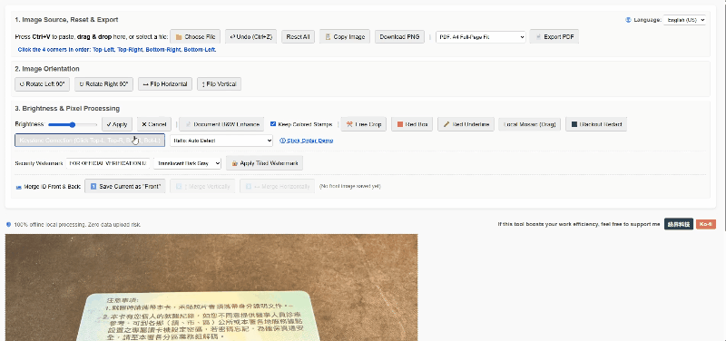

# 🛡️ 行政救星 (Admin Savior)
**純本機離線公文與雙證件影像處理工具 | 100% Offline Document & ID Image Processing Tool**

[繁體中文](#-專案簡介) | [English](#-project-overview)

---

## 📌 專案簡介

**「行政救星 (Admin Savior)」** 是一款專為行政、總務、人資與日常公務需求設計的**純前端 HTML 離線影像處理工具**。

在日常公務中，常需處理身分證、健保卡、存摺或內部公文影像。若使用一般線上工具，檔案須上傳至第三方伺服器，存在嚴重的個資外洩風險。本專案核心宗旨為 **「100% 純本機瀏覽器運算、零伺服器上傳、零資料庫留存」**，所有影像處理皆在使用者端電腦記憶體內完成，即使拔除網路線亦能完整運作，提供最高等級的資安與隱私保障。

🔗 **線上直接使用**：[https://bboypapaya.github.io/admin-savior/](https://bboypapaya.github.io/admin-savior/)

---

## ✨ 核心功能總覽

| 功能分類 | 功能項目 | 技術與實務亮點 |
| :--- | :--- | :--- |
| **📐 幾何與比例校正** | **公文/證件梯形校正** | 依序點擊四個頂點即可將拍歪的文件拉直。內建 **3 倍率十字放大鏡**輔助精準對位，並支援紅點拖曳微調與**標準比例鎖定**（身分證/健保卡 `85.6×54mm`、直式證件、A4 直/橫式）。 |
| **🪪 證件拼接處理** | **雙證件正反面合併** | 支援將目前處理好的畫面暫存為「正面」，接著載入「反面」圖片後，一鍵執行**上下合併**或**左右合併**，自動對齊寬度與留白邊距。 |
| **📄 影像清晰強化** | **公文去陰影與黑白強化** | 採用積分圖局部自適應演算法，有效去除手機翻拍陰影並強化文字對比；支援**「智慧保留彩色印章」**（自動偵測並保留紅色印泥與藍色公章）。 |
| **🔒 隱私防護遮蔽** | **局部馬賽克 & 個資黑塊** | 提供 **局部馬賽克** 與 **⬛ 個資黑塊（去識別化實心遮罩）** 兩種遮蔽工具，皆支援**常駐連續框選模式**，快速塗銷敏感個資。 |
| **🔏 防冒用機制** | **壓印滿版防盜浮水印** | 支援自訂浮水印文字（如：`僅供業務申辦使用 他用無效`），並提供**半透明深灰、印泥紅、公文藍**三種斜向滿版壓印色彩，防止證件遭挪作他用。 |
| **🖍️ 無紙化重點標註** | **紅框標註 & 紅底線標註** | 支援常駐連續繪製紅框與紅底線（紅底線於接近水平時或按住 `Shift` 鍵會**自動拉直**），免去傳統「列印 ➔ 手工畫線 ➔ 重新掃描」的繁瑣流程。 |
| **✂️ 基礎編修轉向** | **矩形裁切、轉向與亮度** | 支援自由拖曳矩形裁切、左右 90° 旋轉、水平/上下翻轉、亮度滑桿調整，以及最多 **15 步復原 (`Ctrl+Z`)**。 |
| **📤 多元輸入與輸出** | **剪貼簿連動 & 離線 PDF** | 支援 **`Ctrl+V` 直接貼上截圖**、滑鼠拖曳圖片或選取檔案；完成後可**一鍵複製圖片**（直接貼回 Word / Excel / LINE）、下載 PNG，或由本機直接生成 **A4 滿版 PDF** 與 **證件 1:1 實際尺寸 PDF**（列印出來即為真實證件大小）。 |

---

## 🌐 支援語系 (9 國語言國際化)

系統會自動偵測瀏覽器語系並記憶使用者偏好，支援即時切換以下 9 種語言（連同預設防盜浮水印文字亦會自動對應轉換）：
* `zh-TW` 繁體中文
* `en-US` English (US)
* `ja` 日本語
* `de` Deutsch
* `ko` 한국어
* `fr` Français
* `nl` Nederlands
* `es` Español
* `sv` Svenska

---

## 🚀 快速使用方式

1. **線上開啟**：直接點擊 [https://bboypapaya.github.io/admin-savior/](https://bboypapaya.github.io/admin-savior/) 即可使用。
2. **純離線保存**：您也可以下載本專案中的 `index.html` 至電腦桌面，未來在無網路環境下直接以瀏覽器（Chrome / Edge / Safari / Firefox）雙擊開啟即可運作。

---

## ☕ 贊助支持與金流審核說明

本工具為**完全免費公開、無任何功能鎖定（No Paywall）**之開放資源，所有使用者無須付費或註冊即可使用 100% 完整功能。

若本工具成功提升了您的日常行政工作效率，歡迎透過頁面底部的贊助連結支持開發者持續維護：
* **國內贊助（綠界科技 ECPay）**：[https://p.ecpay.com.tw/04052B1](https://p.ecpay.com.tw/04052B1)
* **海外贊助（Ko-fi / PayPal）**：[https://ko-fi.com/bboypapaya](https://ko-fi.com/bboypapaya)

> **【綠界科技（ECPay）金流審核說明與免責聲明】**
> 1. 本專案網站（`https://bboypapaya.github.io/admin-savior/`）為實際上線運作之完整網頁應用程式，目前同步作為綠界科技（ECPay）收款連結審查之官方展示頁面，工具完工後將透過 Threads 等社群平台免費分享予大眾使用。
> 2. 頁面內所設置之收款連結純屬使用者基於認同與感謝之「自由隨緣贊助（無對價關係之贈與）」，不涉及任何實體商品販售、付費解鎖權限或專屬客製化客服承諾。
> 3. **聯絡開發者**：`bboy.papaya@gmail.com`

---
---

## 📌 Project Overview

**Admin Savior** is a lightweight, **100% client-side offline HTML document and ID image processing tool** designed for administrative staff, HR professionals, and everyday office workflows.

Processing sensitive images—such as ID cards, health insurance cards, bankbooks, or official documents—on standard online tools carries severe privacy risks due to server uploads. **Admin Savior** processes all pixels locally within your browser's memory using HTML5 Canvas. **Zero data is uploaded to any server**, and the tool functions completely offline.

🔗 **Live Web App**: [https://bboypapaya.github.io/admin-savior/](https://bboypapaya.github.io/admin-savior/)

---

## ✨ Key Features

* **📐 Keystone (Perspective) Correction**: Click 4 corners to straighten skewed document photos. Includes a built-in **3x crosshair magnifier**, draggable corner fine-tuning, and **Standard Aspect Ratio Locking** (ID Card Landscape `85.6×54mm`, ID Portrait `54×85.6mm`, A4 Portrait/Landscape).
* **🪪 ID Card Front & Back Merger**: Temporarily store the processed "Front" image in memory, load the "Back" image, and merge them **Vertically** or **Horizontally** in one click with automatic alignment and padding.
* **📄 Document B&W Enhancement & Stamp Preservation**: Removes uneven lighting and shadows using adaptive integral-image thresholding while offering a smart **"Keep Colored Stamps"** mode to preserve red and blue official seals.
* **🔒 Privacy Redaction (Sticky Modes)**: Features both **Local Mosaic** and **⬛ Blackout Redact (solid black rectangle)** in continuous/sticky drawing mode to quickly mask personally identifiable information (PII).
* **🔏 Tiled Security Watermark**: Apply full-page angled anti-theft watermarks with customizable text and 3 translucent color presets (Dark Gray, Stamp Red, Official Blue).
* **🖍️ Paperless Highlighting**: Draw **Red Boxes** and **Red Underlines** (auto-straightens when near horizontal or holding `Shift`) in continuous mode—eliminating the need to print, highlight by hand, and re-scan.
* **✂️ Crop, Orientation & History**: Free rectangular cropping, 90° rotations, horizontal/vertical flips, brightness adjustment, and up to **15 steps of Undo (`Ctrl+Z`)**.
* **📤 Seamless Input & Local PDF Export**: Paste images directly from your clipboard (`Ctrl+V`), drag & drop files, copy processed images straight back to your clipboard (for Word/Excel/Chat apps), download as PNG, or generate **A4 Full-Page PDFs** and **1:1 Actual-Size ID Card PDFs** entirely offline.

---

## ☕ Support & Contact

**Admin Savior** is 100% free to use with no paywalls or locked features. If this tool boosts your work efficiency, feel free to support the developer:

* **Ko-fi (International)**: [https://ko-fi.com/bboypapaya](https://ko-fi.com/bboypapaya)
* **ECPay (Taiwan Domestic)**: [https://p.ecpay.com.tw/04052B1](https://p.ecpay.com.tw/04052B1)
* **Developer Contact**: `bboy.papaya@gmail.com`
